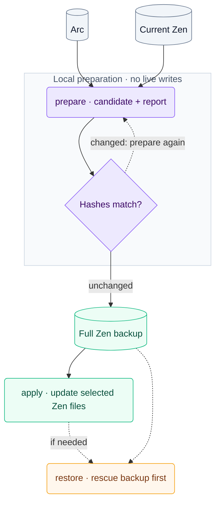

# Arc → Zen

Move your Arc data to Zen on macOS: spaces, pinned tabs, Essentials, open tabs,
history, bookmarks, addresses, form values and search shortcuts. Cookies and an
Arc-like keyboard preset are optional.

The tool prepares a local copy first, then applies it with a complete Zen backup.
[Passwords and extensions](docs/PASSWORDS-AND-EXTENSIONS.md) are handled separately.

## How it works



## Requirements

- macOS, Python 3.11+ and liblz4.
- Arc and Zen opened and closed normally at least once.
- Arc's **Default** profile, flat pinned tabs and Zen workspaces without containers.
  Bookmark folders are supported; pinned sidebar folders are not.

Early release: original adapters were tested with Arc 1.170.0 and Zen 1.23.4b on
one Mac. The packaged CLI has synthetic tests; other versions are not certified.

## Install

```sh
brew install python lz4
git clone https://github.com/kr4chinin/arc2zen.git
cd arc2zen
python3 -m venv .venv
source .venv/bin/activate
python -m pip install -e .
```

## Migrate

List profiles, then quit **both browsers with Cmd+Q** and keep them closed:

```sh
arc2zen discover
arc2zen prepare --zen-profile "/path/from/discover"
```

Review the counts and run the exact `arc2zen apply --run ...` command printed by
preparation. It creates a full backup before updating Zen. Open Zen afterward to
verify the result. If you reopen it before applying, prepare a new run.

To include cookies and the keyboard preset, prepare with:

```sh
arc2zen prepare --zen-profile "/path/from/discover" \
  --parts spaces,tabs,history,bookmarks,addresses,forms,search,cookies,keyboard
```

Approve the macOS **Arc Safe Storage** prompt if cookies are selected.
Use `--parts history,bookmarks` or another subset to limit the transfer.
`spaces` includes pinned tabs and Essentials; `tabs` imports open web tabs into
previously imported spaces or spaces included in the same run.
The keyboard preset maps Cmd+D to pin, Cmd+S to sidebar and Cmd+Option+Return to
duplicate, disabling conflicting bindings.

## Restore

Quit both browsers, then restore an applied run:

```sh
arc2zen restore --run "/path/to/run"
```

Restore stops if files changed after import. After reviewing the backup, use
`--discard-new-data` to allow replacement; a rescue backup is created first.
See [recovery details](docs/COMPATIBILITY.md#recovery) for interrupted runs.

Migration runs stay local and contain private browser data. Keep them outside Git
and never upload them or attach them to issues.

[Compatibility](docs/COMPATIBILITY.md) · [Development](docs/DEVELOPMENT.md)

Based on [noneedofit/arc2zen](https://github.com/noneedofit/arc2zen).
[MIT license](LICENSE) · [Attribution](NOTICE.md)
